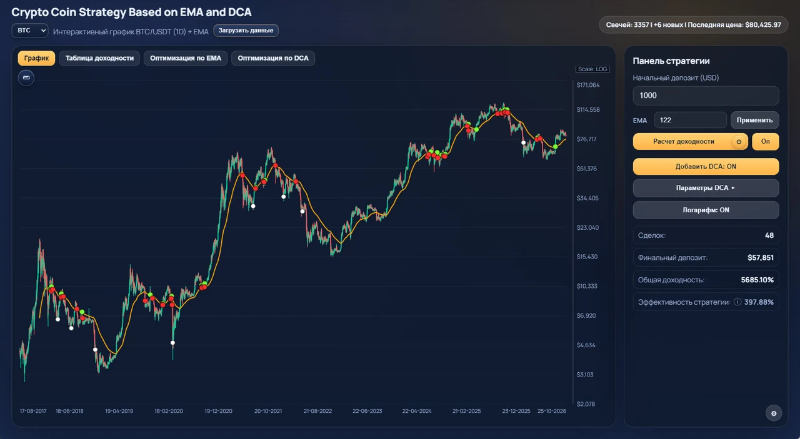

# BTC EMA - исследование стратегий

**Автор проекта:** [Евгений Толмачев](https://github.com/EvgenyET) · [Страница проекта в портфолио](https://evgeny-dev.pro/project.html?id=BTC_ema_strategy)

Настольное приложение для проверки стратегий EMA и DCA на исторических свечах. Интерактивный график, журнал сделок, расчёт просадки и подбор параметров.

## Мой вклад

Написал загрузку и кэширование исторических свечей, построил свечной график на Canvas и реализовал проверку правил EMA и DCA. Связал отметки на графике с журналом сделок, чтобы результат можно было разобрать по отдельным входам и выходам.

## Интерфейс

**Свечной график и параметры расчёта**

**Журнал сделок на исторической выборке**

## Как это работает

Инструмент загружает дневные свечи Binance и сохраняет их в локальном кэше. Пользователь выбирает инструмент, период EMA и параметры стратегии, после чего сравнивает сделки и результаты исторических расчётов. Отдельные режимы позволяют исследовать усреднение DCA и подбирать сочетания параметров.

## Возможности

- Загрузка дневных свечей и дополнение локального кэша без повторного скачивания всей истории.
- Собственный график на Canvas: свечи, EMA, масштабирование, перемещение и отметки сделок.
- Историческая проверка правил пересечения EMA с учётом комиссии и проскальзывания.
- Настройка DCA: размер докупки, шаг снижения цены и условия дальнейшего выхода.
- Таблица сделок, итоговый результат, максимальная просадка и сравнение вариантов параметров.

## Технологии

- **Electron** - Настольная оболочка и IPC для файловых операций.
- **JavaScript** - Расчёт EMA, моделирование сделок и перебор параметров.
- **Canvas API** - Собственная отрисовка графика и его интерактивных элементов.
- **Binance API** - Публичные исторические дневные свечи.
- **JSON** - Локальный кэш свечей и сохранение настроек приложения.

## О проекте

Исследовательское приложение для сравнения торговых правил на одной исторической выборке. Графики, сделки и параметры собраны в общем интерфейсе. Расчёты помогают изучать поведение стратегии при разных настройках.

Коммерческий проект. Исходный код закрыт.
