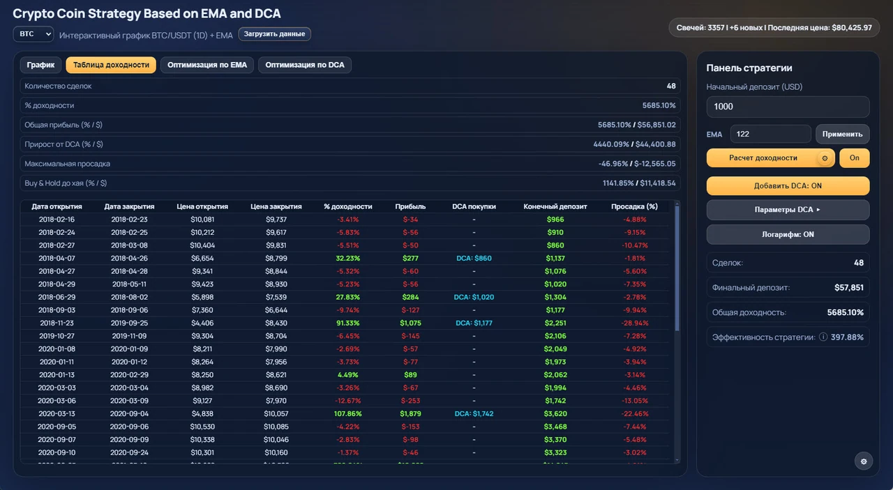

# BTC EMA - исследование стратегий

Автор проекта - **Евгений Толмачев**. [Профиль GitHub](https://github.com/EvgenyET) · [Проект в портфолио](https://evgeny-dev.pro/project.html?id=BTC_ema_strategy)

Приложение для проверки стратегий EMA и DCA на истории Binance. Свечной график, журнал сделок, комиссии, проскальзывание, просадка и подбор параметров в одном окне.

## Задача проекта

Исследовательский инструмент для проверки формализованных торговых правил. Здесь важно видеть связь между параметрами, отдельными сделками и общей просадкой, а также явно учитывать принятые допущения исполнения на дневных свечах.

## Мой вклад

Реализовал загрузку и обновление кэша Binance, расчёт EMA и историческое моделирование стратегий. Написал интерактивный свечной график на Canvas с масштабированием, перемещением и отметками сделок. Связал график с журналом, расчётом результата и просадки, добавил режимы DCA и подбор параметров.

## Интерфейс

**Свечной график и параметры расчёта**

**Журнал сделок на исторической выборке**

## Как работает приложение

BTC EMA позволяет разобрать торговую стратегию на конкретных исторических сделках. Пользователь выбирает инструмент, загружает дневные свечи, задаёт период EMA и правила входа, выхода или усреднения DCA. Приложение рассчитывает сделки с заданными комиссиями и проскальзыванием, отмечает их на графике и выводит итоговую статистику. Перебор параметров помогает сравнить варианты на одной выборке, а локальный кэш ускоряет повторное исследование.

## Возможности

- Загрузка дневных свечей и дополнение локального кэша без повторного скачивания всей истории.
- Собственный график на Canvas: свечи, EMA, масштабирование, перемещение и отметки сделок.
- Историческая проверка правил пересечения EMA с учётом комиссии и проскальзывания.
- Настройка DCA: размер докупки, шаг снижения цены и условия дальнейшего выхода.
- Таблица сделок, итоговый результат, максимальная просадка и сравнение вариантов параметров.

## Техническое устройство

### Настольная оболочка и хранение

Electron управляет окном, сохраняет настройки и кэш свечей по инструментам. Интерфейс обращается к этим операциям через preload.

### Рыночные данные и индикатор

Загрузчик последовательно читает страницы дневных свечей Binance, объединяет их по времени и рассчитывает EMA, начиная с простого среднего за период прогрева.

### График и расчёты

CustomChart отвечает за отрисовку и взаимодействие с Canvas. Функции исторического тестирования моделируют сделки и DCA, а оптимизация сравнивает результаты набора параметров.

## Технологии

| Технология | Роль в проекте |
| --- | --- |
| Electron | Настольная оболочка и IPC для файловых операций. |
| JavaScript | Расчёт EMA, моделирование сделок и перебор параметров. |
| Canvas API | Собственная отрисовка графика и его интерактивных элементов. |
| Binance API | Публичные исторические дневные свечи. |
| JSON | Локальный кэш свечей и сохранение настроек приложения. |

## Состояние показанной версии

- Расчёты выполняются по дневным свечам и являются моделированием исполнения.
- Для обновления истории требуется доступ к публичному API Binance.

## Демонстрация

На странице портфолио доступны описание, галерея и видеодемонстрация проекта. [Открыть BTC EMA - исследование стратегий](https://evgeny-dev.pro/project.html?id=BTC_ema_strategy).
